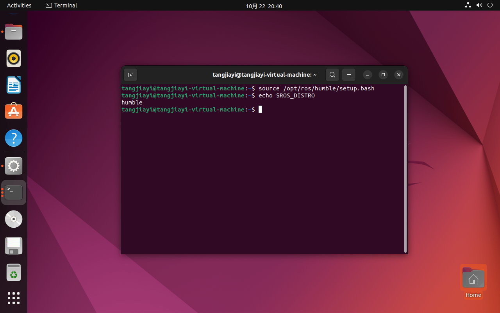
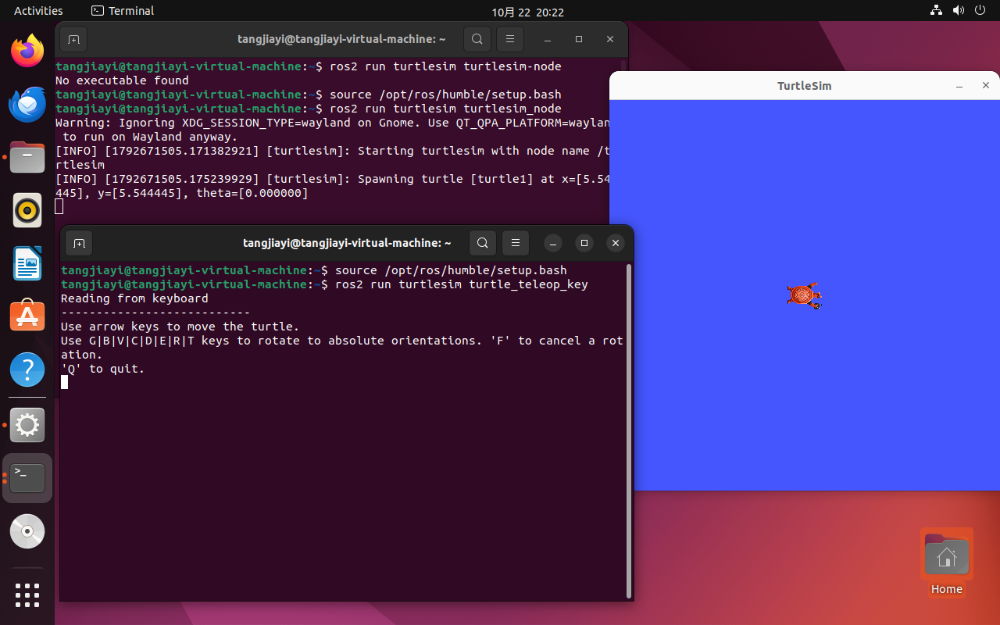
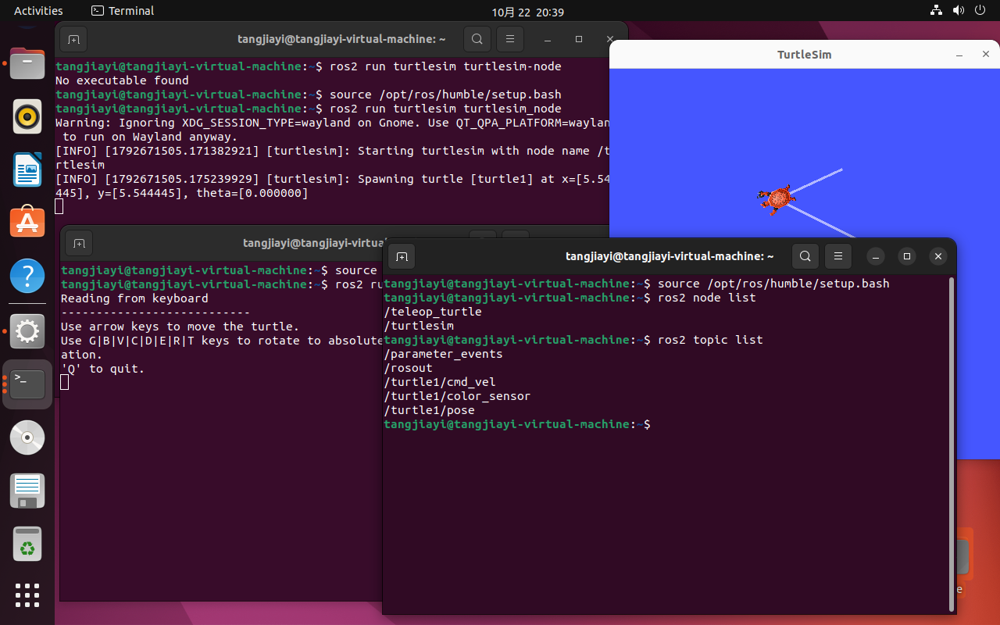

# 第1周考核：ROS2 Humble 小乌龟仿真

- 姓名：唐嘉怡
- 拼音：tangjiayi
- 完成日期：2026-10-23

## 1. ROS 环境校验（必做）

执行 `echo $ROS_DISTRO`，输出 humble，证明 ROS2 环境配置生效。

## 2. 启动 turtlesim 仿真节点 + teleop 键盘控制节点

同时运行两个节点，准备控制小乌龟。

## 3. 键盘控制小乌龟移动，生成运动轨迹

小乌龟成功运动，留下轨迹，仿真任务完成。

## 4. 拓展：ros2 node list 查看活跃节点

## 5. 拓展：ros2 topic list 查看话题列表

本次完成 ROS2 Humble 环境搭建，成功运行 turtlesim 小乌龟仿真，实现键盘控制乌龟移动，同时查看节点与话题。

### 学习心得

这次是我第一次接触 Ubuntu 和 ROS2，装环境的时候踩了很多坑，也慢慢理解了节点、话题这些基础概念。虽然过程有点繁琐，但看到小乌龟成功动起来的时候很有成就感，后续我会继续学习电控相关知识。
